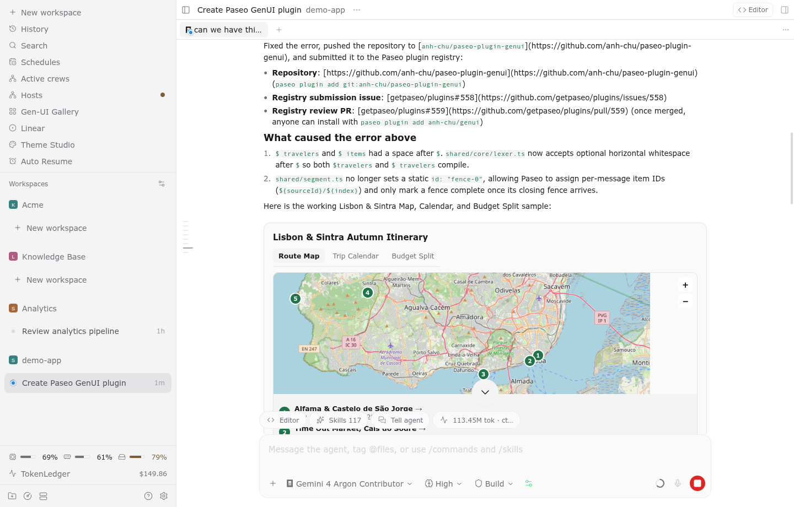
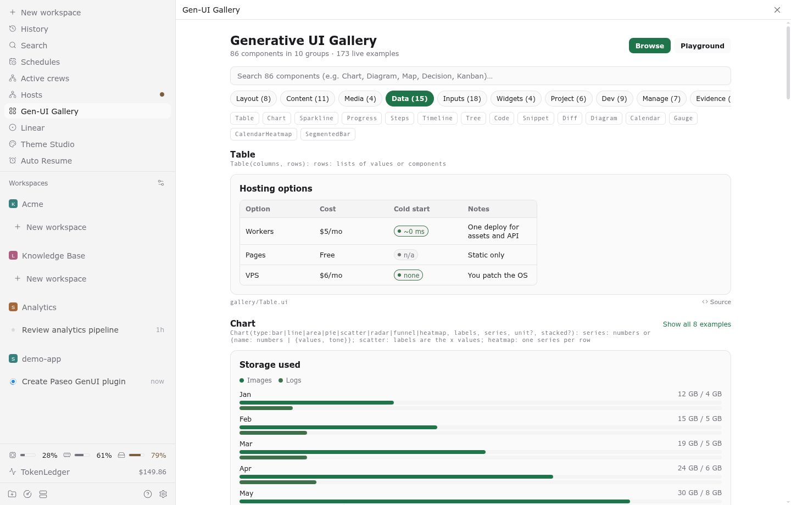
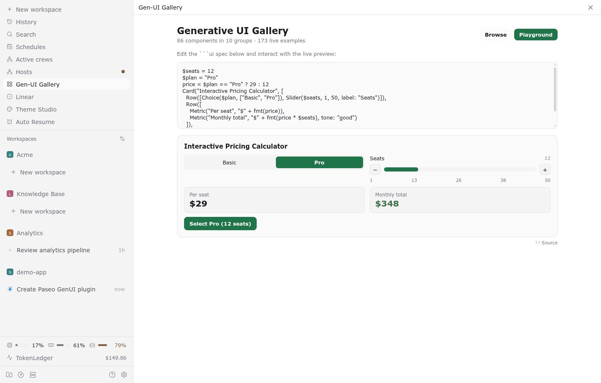

# Generative UI for Paseo

**Agents answer with charts, diagrams, maps, plans, and forms rendered inline in the Paseo chat timeline.**








Ported from [ComicBit/bb-plugin-genui](https://github.com/ComicBit/bb-plugin-genui) (Apache-2.0) to Paseo's native timeline transformer, React Native surface, and daemon RPC architecture.

## Install

```bash
paseo plugin add git:anh-chu/paseo-plugin-genui
```

Or from npm:

```bash
paseo plugin add npm:paseo-plugin-genui
```

Requires a Paseo build newer than 0.15.2 that includes the public `useOpenLink` and `Link` APIs. These APIs are part of the companion Paseo change and have not been released yet.

Links in answers follow Paseo’s **Agent links** preference. Pull request and CI links follow **Pull request links**. On Electron, **Open in Paseo** opens a browser tab in the containing workspace. Other platforms and screens without a workspace browser open links externally.

## What an answer looks like

The agent writes a UI spec as a ```ui block in its reply, after a plain answer sentence. If a block fails, the plugin asks the agent once to fix it. Agents can also pass a spec and a one-sentence answer to the optional `render_ui` tool, which checks the spec first and adds the card only when it renders; the plugin shows the answer as text above the card. Agents used UI far more often with blocks than with the tool, so blocks are the default.

A spec looks like this:

~~~
```ui
$seats = 12
$plan = "Pro"
price = $plan == "Pro" ? 29 : 12
Card("Estimate", [
  Row([Choice($plan, ["Basic", "Pro"]), Slider($seats, 1, 50, label: "Seats")]),
  Metric("Total", "$" + fmt(price * $seats)),
  Button("Go with " + $plan, Send("Go with " + $plan), variant: "primary")
])
```
~~~

Paseo renders a card with a plan switch, a seat slider, and a live total. Moving the slider recomputes the total in place without another model call. Clicking the button sends your choice back to the agent.

## Replies you build

Cards can collect a reply before anything is sent. A button with `Queue(text)` adds its text to your reply instead of sending it. `comments: true` adds a Comment action to each item of a Plan, Steps, List, Table, Findings, Decision or OptionCards, and `editable: true` lets you rewrite an item's text. `Other()` opens a box for anything the agent did not offer. A pill in the composer shows what is queued; the next Send, or Send now in the pill, sends it all as one message.

## Components (88 across 10 groups)

| Group | Components |
| --- | --- |
| **Layout** | `Card` · `Row` · `Stack` · `Grid` · `Tabs` · `Details` · `Divider` · `Carousel` |
| **Content** | `Text` · `Callout` · `Draft` · `Metric` · `Badge` · `Icon` · `KeyValue` · `Image` · `File` · `Entity` · `Sources` · `List` |
| **Data** | `Table` · `Chart` (bar, line, area, pie, scatter, radar, funnel, heatmap) · `Sparkline` · `Progress` · `Gauge` · `SegmentedBar` · `Steps` · `Timeline` · `Calendar` · `CalendarHeatmap` · `Tree` · `Code` · `Snippet` · `Diff` · `Diagram` |
| **Media** | `ImageSearch` · `Gallery` · `Map` · `Hotspots` |
| **Inputs** | `Slider` · `Stepper` · `Toggle` · `Choice` · `Radio` · `Select` · `Checklist` · `ListEditor` · `Input` · `TextArea` · `DateInput` · `Rating` · `OptionCards` · `Swatches` · `EditableTable` · `Button` · `Form` · `FollowUps` · `Other` |
| **Widgets** | `Timer` · `Quiz` · `Flashcards` · `Walkthrough` |
| **Project** | `Changes` · `Commits` · `PullRequest` · `Threads` · `Tests` · `Json` |
| **Dev** | `Logs` · `StackTrace` · `Findings` · `Coverage` · `Dependencies` · `Pipeline` · `Benchmark` · `Waterfall` · `Treemap` |
| **Manage** | `Board` · `Roadmap` · `Status` · `Plan` · `Decision` · `Estimate` · `Environments` |
| **Evidence** | `Acceptance` · `Compare` · `Transcript` · `Provenance` |

## Slash commands & surfaces

- `/genui [prompt]` — Teach an existing agent the Generative UI component language.
- `/genui-demo [ComponentName]` — Insert a live interactive Gen-UI block into the current chat (e.g. `/genui-demo Decision` or `/genui-demo Map`).
- `/genui-gallery` — Open the **Gen-UI Gallery** screen (176 examples across all 88 components, plus a live spec Playground).

## Develop

Until the companion SDK is published, build and pack `@getpaseo/plugin` from the Paseo worktree containing the new APIs. After installing this repository’s dependencies, use `npm install --no-save --package-lock=false /absolute/path/to/getpaseo-plugin-<version>.tgz` to check against that local SDK. The lockfile tracks the latest published SDK; it does not yet contain the new API declarations.

```bash
npm install
npm run typecheck && npm test
paseo plugin install .
paseo plugin reload genui
```

## License

[Apache-2.0](LICENSE). Original DSL, component catalog, and gallery examples by [ComicBit](https://github.com/ComicBit/bb-plugin-genui). Excalifont is under the SIL Open Font License (`assets/fonts/Excalifont-OFL.txt`).
